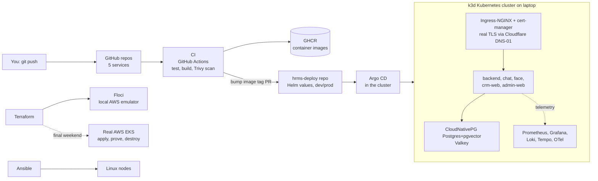

# HRMS DevOps Lab: Roadmap

A hands-on DevOps capstone. The services of a real multi-service HRMS platform are built, shipped, run and observed with the
industry-standard stack, **on purpose more than the product needs**, to learn every course module end to end.

> **This is a lab, not production.** The real deployment stays on a simple Docker Compose setup.
> Nothing here touches the live servers, the live database or real personal data.

---

## 1. The big picture



**One sentence:** a commit to any service becomes a scanned image, a Git change in the deploy repo, and a rollout
that Argo CD applies to Kubernetes, with HTTPS, managed secrets, a real Postgres operator, and full metrics, logs
and traces, while the infrastructure under it is code (Terraform + Ansible).

---

## 2. Course module → what you build

| Course module | Phase | Hands-on on the HRMS |
|---|---|---|
| 2 Linux | 0, 8 | WSL Ubuntu workstation, users, permissions, systemd, hardening nodes |
| 3 Networking | 3, 7 | DNS, ports, Ingress, TLS, VPC/subnets/security groups in Terraform |
| 4 Shell scripting | 0, 5 | Bootstrap scripts, Postgres backup/restore drill script |
| 5 Git (GitHub/GitLab) | 1, 4 | Branch protection, PR flow, deploy repo, GitOps |
| 6 Jira | all | Every phase is an Epic, every task a Story |
| 7 Docker | 1 | Production Dockerfiles for 5 services |
| 8 GitHub Actions | 2 | CI for every repo |
| 9 Kubernetes | 3, 5 | k3d cluster, Helm charts, operators, stateful workloads |
| 10 Terraform | 7, 9 | AWS infra on Floci, then real AWS |
| 11 Ansible | 8 | Node configuration and k3s install |
| 12 SRE / Observability | 6 | Prometheus, Grafana, Loki, Tempo, OTel, SLOs, alerts |
| 13 GitOps | 4 | Argo CD, app-of-apps, dev → prod promotion |

---

## 3. Lab environment

| Thing | Choice | Why |
|---|---|---|
| Laptop | 16 GB RAM, i5-11400H (6c/12t), Docker 29 | RAM is the bottleneck: cap WSL at ~10 GB, never run every stack at once |
| Daily Kubernetes | **k3d** (k3s in Docker), 1 server + 2 agents | Real multi-node behaviour (scheduling, drain, PDB) at laptop cost |
| AWS practice | **Floci** on `localhost:4566` | Free local AWS emulator; Terraform's normal AWS provider works against it |
| Real cloud | **AWS, one weekend** at the end | Prove the Terraform works for real, then destroy. Budget alarm first |
| Domain | Bought at **Cloudflare Registrar**: `<your-domain>` | Real DNS, real Let's Encrypt certs via DNS-01, ExternalDNS |
| Registry | **GHCR** (GitHub Container Registry), **private** packages | Images of private code stay private; the cluster pulls with an `imagePullSecret` (read-only token) |
| CI minutes | GitHub Free: limited Actions minutes/month on private repos | Cache aggressively, run heavy jobs only on `main`/PRs |
| Lab hostnames | `*.lab.<your-domain>` → `127.0.0.1`, DNS-only (grey cloud) | Private IP, so the Cloudflare proxy must stay off |

---

## 4. Repos and folders

```
hrms-devops-lab/                       ← this repo: own git repo, PUBLIC
  docs/                                ← roadmap, per-phase notes, interview stories
  terraform/                           ← Phase 7/9: AWS infra (envs/floci, envs/aws)
  ansible/                             ← Phase 8: inventories, roles, playbooks
  k3d/                                 ← Phase 3: cluster config
  scripts/                             ← bootstrap, backup/restore drill

hrms-deploy/                           ← Phase 4: the GitOps repo Argo CD watches (PRIVATE)
  charts/<service>/                    ← one Helm chart per service
  platform/                            ← ingress, cert-manager, CNPG, observability…
  envs/dev/  envs/prod/                ← per-environment values, image tags pinned
  apps/                                ← Argo CD app-of-apps

Service repos (already exist, PRIVATE) ← get Dockerfile, .github/workflows/
  backend, chat, face, crm-web, admin-web
```

Lab work in a service repo (Dockerfile, CI workflow) stays real and useful for production too. Anything only
the lab needs lives in this folder or `hrms-deploy`.

---

## 5. The phases

Each phase has: **Goal**, **Hands-on**, **You learn**, **Done when** (a check you can demo), and
**Interview story** (what you can say about it).

### Phase 0: Workstation setup
- **Goal:** a Linux toolbox on Windows.
- **Hands-on:** WSL2 Ubuntu; `.wslconfig` memory cap; **gitleaks pre-commit hook** on this public repo; install `kubectl`, `helm`, `k3d`, `terraform`, `ansible`,
  `trivy`, `floci`, `jq`, `yq`, `argocd` CLI; shell aliases; a `scripts/check-tools.sh` that verifies versions.
- **You learn:** WSL networking, package managers, PATH, shell scripting basics.
- **Done when:** `scripts/check-tools.sh` prints every tool with its version and exits 0.

### Phase 1: Docker: production images
- **Goal:** small, secure, cache-friendly images for all 5 services.
- **Hands-on:** review and rewrite the existing Dockerfiles: multi-stage builds, non-root user, pinned base
  images, layer caching (deps before source), `.dockerignore`, `HEALTHCHECK`, JVM container memory flags,
  Next.js standalone output, slim Python image for face. Compare image sizes before and after.
- **You learn:** layers, build cache, attack surface, why distroless/alpine/slim differ.
- **Done when:** every image builds, runs as non-root, and a size table (before/after) is in `docs/`.
- **Interview story:** "I cut the backend image from X MB to Y MB and removed root, here's how."

### Phase 2: CI: GitHub Actions
- **Goal:** every push is tested, built, scanned and published automatically.
- **Hands-on:** Actions workflow per repo: test → build → **Trivy** scan (fail on CRITICAL) → push to GHCR,
  tagged with the commit SHA; dependency caching. (Branch protection: not enforceable on private repos on GitHub Free; practised on the public lab repo.)
- **You learn:** pipelines as code, runners/agents, secrets in CI, immutable tags, supply-chain scanning.
- **Done when:** a PR shows green checks; GHCR has SHA-tagged images for all five services.
- **Interview story:** "The scan gate caught real CRITICALs on day one (Spring, Next.js RCEs, anyio), and Linux-only test bugs Windows hid."

### Phase 3: Kubernetes
- **Goal:** the HRMS running on a multi-node cluster, reachable over real HTTPS.
- **Hands-on:** k3d cluster (1 server, 2 agents); a **Helm chart per service** with Deployment, Service,
  Ingress, ConfigMap, liveness/readiness/startup probes, resource requests/limits, HPA, PodDisruptionBudget;
  Ingress-NGINX; **cert-manager** + Let's Encrypt via **Cloudflare DNS-01** (zone-scoped API token);
  **ExternalDNS** creating records from Ingresses; namespaces per environment.
- **You learn:** pods, scheduling, services, ingress, probes, autoscaling, `kubectl drain`, Helm templating.
- **Done when:** `https://api.lab.<your-domain>` serves the backend with a valid certificate; draining a node
  keeps the app up.

### Phase 4: GitOps with Argo CD
- **Goal:** deploys happen only through Git.
- **Hands-on:** private `hrms-deploy` repo, read by Argo CD through a **read-only deploy key**;
  Argo CD with the **app-of-apps** pattern; `dev` and `prod`
  environments; CI opens a PR bumping the image tag; auto-sync for dev, manual sync for prod; drift test
  (change something with `kubectl`, watch Argo CD revert it); rollback with `git revert`.
- **You learn:** declarative vs imperative, pull-based deploys, reconciliation, environment promotion.
- **Done when:** merge a PR → new version is live with no `kubectl apply` by hand; a revert rolls it back.
- **Interview story:** "Why pull-based GitOps is safer than CI pushing to the cluster."

### Phase 5: Secrets and stateful services
- **Goal:** no plain secrets anywhere; a real database operator with backups.
- **Hands-on:** **Sealed Secrets** (or SOPS + age) for every credential; **CloudNativePG** Postgres with
  pgvector, 1 primary + 1 replica, scheduled backups to MinIO (S3-compatible); Valkey via Helm;
  `scripts/restore-drill.sh` that restores the latest backup to a fresh cluster and checks row counts;
  failover test (kill the primary pod).
- **You learn:** operators/CRDs, PersistentVolumes, StatefulSets, backup vs restore, RPO/RTO.
- **Done when:** the restore drill passes and a primary kill causes automatic failover.
- **Interview story:** "A backup you haven't restored is not a backup. Here's my drill."

### Phase 6: SRE and observability
- **Goal:** know when it breaks and why, before users tell you.
- **Hands-on:** **kube-prometheus-stack** (Prometheus, Grafana, Alertmanager); **Loki** + Alloy for logs
  (JSON logs from the backend, PII scrubbing rules); **Tempo** + **OpenTelemetry** (Java agent on
  backend/chat, FastAPI instrumentation on face) so one attendance check-in is one trace across services;
  dashboards; **SLOs** (e.g. 99.5% of `/api` requests succeed, p95 < 500 ms) with burn-rate alerts;
  a deliberate failure (kill face, slow the DB) and a written post-mortem.
- **You learn:** the three signals, RED/USE methods, SLI/SLO/error budgets, alert fatigue, post-mortems.
- **Done when:** a broken face service fires an alert, and the trace shows exactly which call failed.

### Phase 7: Terraform on Floci
- **Goal:** the AWS version of this platform, as code.
- **Hands-on:** modules for VPC (public/private subnets, NAT, route tables), security groups, ECR, S3 +
  DynamoDB-style state locking, IAM roles, EKS, RDS Postgres, Route 53 records; `envs/floci` and `envs/aws`
  sharing the same modules; `fmt`/`validate`/`tflint`/`checkov` in CI; `plan` posted on PRs.
- **You learn:** state, modules, variables/outputs, workspaces vs folders, drift, remote state.
- **Done when:** `terraform apply` on Floci builds everything; `terraform destroy` removes it cleanly.

### Phase 8: Ansible
- **Goal:** servers configured by code, never by hand.
- **Hands-on:** inventory, roles for base hardening (users, SSH keys only, ufw, fail2ban, unattended
  upgrades), Docker, and k3s install; idempotency check (second run = 0 changes); Ansible Vault for secrets.
  Targets: Floci EC2 containers if SSH-reachable, otherwise Docker containers running sshd as stand-in nodes.
- **You learn:** inventories, roles, handlers, idempotency, Terraform vs Ansible boundaries.
- **Done when:** a fresh node goes from blank to a working k3s agent with one playbook run.

### Phase 9: Real AWS (one weekend)
- **Goal:** proof it works outside the laptop.
- **Hands-on:** AWS account with **MFA on root, an IAM admin user, and a budget alarm before anything else**;
  `terraform apply` on `envs/aws`; Argo CD points at the same `hrms-deploy` repo; screenshots and a
  cost log; `terraform destroy` the same weekend.
- **You learn:** real cloud costs, quotas, how slow EKS really is, IAM in practice.
- **Done when:** the app was live on EKS, the bill is a few dollars, and everything is destroyed.

### Phase 10 (bonus): Hardening and progressive delivery
- NetworkPolicies (default deny), **Kyverno** policies (no root, no `:latest`, limits required),
  **Cosign** image signing verified at admission, **Argo Rollouts** canary with automatic rollback on bad metrics.

---

## 6. Ground rules

0. **Public vs private.** This repo is **public**. The 5 service repos and `hrms-deploy` are **private, forever**.
   Never copy application source, real `.env` values, internal hostnames/IPs, API docs, audit findings or
   screenshots with real data into this repo. Show work here through write-ups, diagrams and short sanitized
   snippets (e.g. a Dockerfile pattern), not by pasting private files. **gitleaks** runs as a pre-commit hook here.
1. **No secrets in Git, chat or screenshots.** Tokens go into Sealed Secrets, Ansible Vault or CI secrets.
2. **No real personal data.** Seed the lab with fake data only.
3. **Never touch the real production servers** from this lab.
4. **Least privilege everywhere:** the Cloudflare token edits DNS of one zone only; the AWS user is not root.
5. **Write it down:** each phase ends with `docs/phase-N-notes.md`: what you built, why, what broke, how you fixed it.
6. **You write, Claude reviews.** Boilerplate can be generated, but you must be able to explain every line.
7. **Tear down what you don't use.** Stop stacks to save RAM; destroy cloud resources to save money.

---

## 7. Jira

One project, **HRMSLAB**. One **Epic per phase**; each "Hands-on" bullet is a **Story**; bugs found along
the way are **Bugs** linked to the story. Use a simple board: To Do → In Progress → Review → Done. Screenshots
of the board belong in your portfolio.

---

## 8. What goes on the resume (when done)

- Containerised 5 polyglot microservices (Java/Spring, Python/FastAPI, Next.js) with hardened multi-stage
  images; cut image size by X%.
- Built CI with GitHub Actions for five services: tests, Trivy scanning and SHA-tagged images to GHCR.
- Ran the platform on Kubernetes with Helm, Ingress-NGINX, cert-manager (Let's Encrypt DNS-01) and ExternalDNS.
- Implemented GitOps with Argo CD (app-of-apps, dev/prod promotion, Git-based rollback).
- Operated PostgreSQL + pgvector with CloudNativePG: replication, automated backups, tested restores and failover.
- Built observability with Prometheus, Grafana, Loki, Tempo and OpenTelemetry; defined SLOs with burn-rate alerts.
- Provisioned AWS (VPC, EKS, RDS, IAM, Route 53) with Terraform modules; configured nodes with Ansible.
- Deployed to real AWS EKS and tore it down cost-consciously.

Replace each bullet's numbers with your real measurements as you finish each phase.

---

## 9. Progress

| Phase | Status | Notes |
|---|---|---|
| Domain + Cloudflare DNS | 🟡 Almost | Bought at Cloudflare, 2FA on; confirm the `nslookup` test, then delete the `test` record |
| 0 Workstation | ✅ Done | WSL Ubuntu 24.04 capped at 10 GB, 13 pinned + checksum-verified tools, `check-tools.sh` green, gitleaks pre-commit. See [phase notes](phase-0-notes.md) and [bash cheatsheet](cheatsheets/bash-scripting.md) |
| 1 Docker | ✅ Done | All 5 images: numeric non-root, healthy, graceful stop. Per commit 173 MB → ~3 MB (backend), 45 → 3.2 MB (web). ML model baked in. See [phase notes](phase-1-notes.md) and [cheatsheet](cheatsheets/dockerfile-from-scratch.md) |
| 2 CI | ✅ Done | GitHub Actions for all 5: tests, hadolint, Trivy gate (fixable CRITICAL), SHA-tagged images in GHCR. Gate found 14 CRITICALs on first runs, all fixed. Branch protection skipped (GitHub Free, private repos). See [phase notes](phase-2-notes.md) |
| 3 Kubernetes | ⬜ | |
| 4 GitOps | ⬜ | |
| 5 Secrets + state | ⬜ | |
| 6 Observability | ⬜ | |
| 7 Terraform | ⬜ | |
| 8 Ansible | ⬜ | |
| 9 Real AWS | ⬜ | |
| 10 Bonus | ⬜ | |
