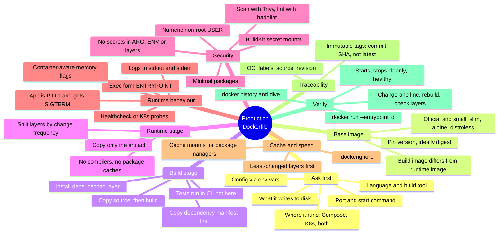

# Writing a Production Dockerfile from Scratch

How I approach "write a Dockerfile for this app" in an interview or on the job: the questions I ask first,
the order I build it in, the templates I start from, and the mistakes I check for before calling it done.

All examples are generic. The numbers in section 7 are real measurements from this lab.

---

## 1. Mind map



---

## 2. Questions to ask before writing a line

Interviewers notice whether you ask these first. Each answer changes the file.
Section 8 walks through the whole thinking method, step by step.

| Question | Why it matters |
|---|---|
| Language, version, build tool? | Picks the build and runtime base images |
| What port, and what is the start command? | `EXPOSE`, `ENTRYPOINT` |
| How is it configured? | Env vars at runtime, never baked into the image |
| Does it write to disk? (logs, uploads, temp) | Volumes, ownership, read-only root filesystem |
| Where does it run? Compose, Kubernetes, both? | Healthcheck vs probes, which tools must stay in the image |
| Any native dependencies? (OpenCV, libpq, fonts) | Alpine (musl) can break them; slim (glibc) is safer |
| Single architecture or ARM too? | `docker buildx` multi-platform builds |

---

## 3. The order I write it in

Say each step out loud in an interview: the reasoning is what's being graded.

1. **`# syntax=docker/dockerfile:1`** so BuildKit features (cache and secret mounts) are available.
2. **Build stage `FROM`** with the full toolchain (JDK + Maven, Node, Python with build tools).
3. **Copy only the dependency manifest** (`pom.xml`, `package.json` + lockfile, `requirements.txt`) and
   install dependencies. This layer stays cached until dependencies change.
4. **Copy the source and build.**
5. **Runtime stage `FROM`**: the smallest image that can run the artifact (JRE not JDK, `-slim`, distroless).
6. **Create a user with a fixed numeric UID/GID.**
7. **Copy the artifact**, least-changed parts first, owned by that user (`COPY --chown`).
8. **`USER <uid>:<gid>`** by number, so Kubernetes `runAsNonRoot` can verify it.
9. **`EXPOSE`**, runtime `ENV` defaults (no secrets).
10. **Healthcheck** if it runs under Compose; Kubernetes uses its own probes instead.
11. **OCI labels** (`org.opencontainers.image.source`, `.revision`) from a build `ARG`.
12. **Exec-form `ENTRYPOINT`** so the app is PID 1 and receives `SIGTERM`.
13. **`.dockerignore`**, then **build, measure, scan**.

---

## 4. Templates

### Java / Spring Boot (Maven)

```dockerfile
# syntax=docker/dockerfile:1
FROM maven:3.9-eclipse-temurin-21 AS build
WORKDIR /src
COPY pom.xml .
RUN mvn -B -q dependency:go-offline
COPY src ./src
RUN mvn -B -q package -DskipTests \
 && cp target/*.jar app.jar \
 && java -Djarmode=tools -jar app.jar extract --layers --destination extracted

FROM eclipse-temurin:21-jre-noble
WORKDIR /app
RUN groupadd -r -g 10001 app && useradd -r -u 10001 -g app app
# Least-changed first: dependencies rarely change, application changes every commit
COPY --from=build --chown=10001:10001 /src/extracted/dependencies/ ./
COPY --from=build --chown=10001:10001 /src/extracted/spring-boot-loader/ ./
COPY --from=build --chown=10001:10001 /src/extracted/snapshot-dependencies/ ./
COPY --from=build --chown=10001:10001 /src/extracted/application/ ./
USER 10001:10001
EXPOSE 8080
# Heap follows the container memory limit; crash on OOM so the orchestrator restarts it
ENV JAVA_TOOL_OPTIONS="-XX:MaxRAMPercentage=75.0 -XX:+ExitOnOutOfMemoryError"
ARG GIT_SHA=unknown
LABEL org.opencontainers.image.revision="${GIT_SHA}"
ENTRYPOINT ["java", "-jar", "app.jar"]
```

### Python / FastAPI

```dockerfile
# syntax=docker/dockerfile:1
FROM python:3.12-slim AS build
WORKDIR /src
RUN python -m venv /venv
ENV PATH="/venv/bin:$PATH"
COPY requirements.txt .
RUN --mount=type=cache,target=/root/.cache/pip pip install -r requirements.txt

FROM python:3.12-slim
WORKDIR /app
RUN groupadd -r -g 10001 app && useradd -r -u 10001 -g app app
COPY --from=build /venv /venv
COPY --chown=10001:10001 app/ ./app/
ENV PATH="/venv/bin:$PATH" \
    PYTHONDONTWRITEBYTECODE=1 \
    PYTHONUNBUFFERED=1
USER 10001:10001
EXPOSE 8000
ENTRYPOINT ["uvicorn", "app.main:app", "--host", "0.0.0.0", "--port", "8000"]
```

`PYTHONUNBUFFERED=1` makes logs appear immediately in `docker logs` instead of sitting in a buffer.

### Node / Next.js (standalone output)

```dockerfile
# syntax=docker/dockerfile:1
FROM node:22-alpine AS deps
WORKDIR /src
COPY package.json package-lock.json ./
RUN npm ci

FROM node:22-alpine AS build
WORKDIR /src
COPY --from=deps /src/node_modules ./node_modules
COPY . .
RUN npm run build          # next.config: output: 'standalone'

FROM node:22-alpine
WORKDIR /app
ENV NODE_ENV=production HOSTNAME=0.0.0.0 PORT=3000
COPY --from=build --chown=1000:1000 /src/.next/standalone ./
COPY --from=build --chown=1000:1000 /src/.next/static ./.next/static
COPY --from=build --chown=1000:1000 /src/public ./public
# 1000 is the image's built-in "node" user. (Dockerfile has no end-of-line comments
# outside RUN, so this note can't sit on the USER line itself.)
USER 1000:1000
EXPOSE 3000
ENTRYPOINT ["node", "server.js"]
```

`npm ci` (not `npm install`) installs exactly what the lockfile says, so builds are reproducible.

### `.dockerignore` (start from this)

```
.git
**/node_modules
**/target
**/__pycache__
**/.env
**/.env.*
*.log
.idea
.vscode
Dockerfile*
docker-compose*
```

---

## 5. Concepts interviewers ask about

| Question | Short answer |
|---|---|
| Why multi-stage? | Build tools stay in the build stage; the runtime image ships only what runs. Smaller and fewer CVEs |
| `CMD` vs `ENTRYPOINT`? | `ENTRYPOINT` is the program; `CMD` is its default arguments, easy to override. Together: fixed program, overridable args |
| Exec form vs shell form? | Exec form (`["java", ...]`) runs the app as PID 1 so it gets `SIGTERM`. Shell form wraps it in `sh -c`, which can swallow signals: the container is killed after the grace period instead of shutting down cleanly |
| `COPY` vs `ADD`? | Use `COPY`. `ADD` also unpacks archives and downloads URLs: surprising behaviour |
| `ARG` vs `ENV`? | `ARG` exists only at build time; `ENV` is also set in the running container. Neither is safe for secrets: both show up in `docker history` |
| How do you pass a secret at build time? | `RUN --mount=type=secret,id=npmrc ...` with `docker build --secret`. It never lands in a layer |
| Why copy the manifest before the source? | Docker caches layer by layer. Dependencies change rarely, source often, so the expensive install stays cached |
| Why a numeric `USER`? | Kubernetes `runAsNonRoot` checks the UID number; it can't resolve names inside the image |
| Alpine vs slim vs distroless? | Alpine: smallest, but musl libc breaks some native libs. Slim: Debian, glibc, safe default. Distroless: no shell or package manager, smallest attack surface, harder to debug |
| Does Kubernetes use `HEALTHCHECK`? | No. It uses liveness, readiness and startup probes defined in the pod spec |
| Why not `:latest`? | It's mutable: you can't tell what's running or roll back reliably. Tag with the commit SHA |
| Container logs? | Write to stdout/stderr; the runtime collects them. Files inside the container disappear with it |
| Why does memory matter for the JVM? | The heap must fit inside the container's memory limit, or the kernel OOM-kills the process. `MaxRAMPercentage` sizes it from the cgroup limit |

---

## 6. Mistakes I check for before calling it done

- [ ] Runs as root (no `USER`), or `USER` given as a name only
- [ ] Secrets in `ARG`/`ENV`, or a `.env` file copied into the image
- [ ] `COPY . .` before installing dependencies: every code change re-downloads everything
- [ ] `apt-get update` in one `RUN` and `install` in another: stale cache; clean `/var/lib/apt/lists/*` in the **same** `RUN`
- [ ] Compilers or build tools left in the runtime image
- [ ] Shell-form `ENTRYPOINT`: app isn't PID 1
- [ ] No `.dockerignore`
- [ ] Base image `:latest` or unpinned
- [ ] Logs written to files inside the container
- [ ] Image not scanned (`trivy image `) or linted (`hadolint Dockerfile`)

---

## 7. Verify it: commands and the lab's real numbers

```bash
docker build -t app:test --build-arg GIT_SHA=$(git rev-parse --short HEAD) .
docker images app:test                                           # size
docker history app:test --format "{{.Size}}\t{{.CreatedBy}}"     # which layer is big
docker run --rm --entrypoint id app:test                         # not root?
docker inspect app:test --format '{{.Config.User}} {{json .Config.Entrypoint}}'
trivy image --severity HIGH,CRITICAL app:test                    # vulnerabilities
hadolint Dockerfile                                              # lint
```

**Layer test:** change one line of source, rebuild, and compare `docker inspect --format '{{.RootFS.Layers}}'`
between the two images. Only the small application layer should differ.

**Measured in this lab** (Spring Boot service, 262 MB compressed image):

| | Fat jar | Layered jar |
|---|---|---|
| Dependencies inside the jar | 169.5 MB | own cached layer, 170 MB |
| Application code + resources | 6.8 MB | own layer, 3.1 MB |
| **Pushed/pulled per code commit** | **~173 MB** | **~3 MB (~55× less)** |

Total image size didn't change: layering doesn't make images smaller, it makes **updates** smaller.

### Lessons learned from the real migration

1. **One image, several environments.** The same image ran under production Docker Compose and in the
   Kubernetes lab. Removing `wget` and `HEALTHCHECK` (useless in Kubernetes) would have broken the Compose
   healthcheck. Check every consumer of an image before changing it.
2. **Changing a container's UID is a data migration.** Files on an existing volume were owned by UID 999. Moving
   to UID 10001 would have made them read-only to the app. The fix was to pin the existing number, not pick a new one.
3. **Switching `JAVA_OPTS` to `JAVA_TOOL_OPTIONS`** removed the shell from `ENTRYPOINT`, but the Compose file still set
   `JAVA_OPTS`, so production would have silently lost its memory flags. Renaming an env var means updating every
   place that sets it.
4. **If a number looks wrong, measure it a second way.** A glob in `unzip -l` reported 16 KB of application code;
   a recount with `awk` gave the real 6.8 MB.

### Lessons from the ML service (Python, face recognition)

5. **Read the startup log of the running container.** It showed `Downloading buffalo_l.zip from github.com...`:
   the ML library fetched a 288 MB model **on every container start**. Slow restarts, and no start at all without
   internet. Fix: a separate build stage downloads the model once, **verifies its SHA-256**, and the runtime
   stage copies it to the path the library checks first, so it skips the download.

   ```dockerfile
   FROM debian:trixie-slim AS models
   ARG MODEL_URL=https://example.com/model.zip
   ARG MODEL_SHA256=<sha256 of the file>
   RUN apt-get update && apt-get install -y --no-install-recommends ca-certificates curl unzip \
    && curl -fsSL -o /tmp/model.zip "$MODEL_URL" \
    && echo "$MODEL_SHA256  /tmp/model.zip" | sha256sum -c - \
    && mkdir -p /models/m && unzip -q /tmp/model.zip -d /models/m
   # runtime stage:
   # COPY --from=models /models/m /home/app/.cache-dir/models/m
   ```
6. **`pip list` inside the image finds duplicates.** `opencv-python` (from requirements) and
   `opencv-python-headless` (pulled in by a dependency) were both installed: ~230 MB of duplicated libraries plus
   a graphics stack (`libgl1`) a server never uses. Pinning only the headless build cut the system-package layer
   from 237 MB to 18 MB.
7. **"Latest Python" means latest the dependencies support.** The newest Python had no wheels yet for the ML
   runtime, so the image uses the newest version that every dependency builds for. Check PyPI wheel tags
   (`cp314`, `cp315`...) before choosing.
8. **Upgrading an ML stack: prove the outputs didn't change.** Embeddings stored in the database came from the old
   numpy/onnxruntime. Same test image through old and new stacks: cosine similarity 1.000000, max difference
   0.000045. Without that check, an upgrade could silently stop matching every stored record.
9. **Test with the network off.** `docker run --network none` proves the image needs nothing from the internet at
   runtime.

| ML service | Before | After |
|---|---|---|
| Model at startup | 288 MB download, every start | baked in, checksum-verified |
| Starts offline | no | yes |
| System packages layer | 237 MB | 18 MB |
| Python | 3.10 (end of life) | 3.14 |

### Lessons from the realtime service (Spring Boot + Socket.IO)

10. **A copied pattern carries hidden assumptions.** The healthcheck was copied from another service:
    `wget --spider`. `--spider` sends **HEAD**, but this service's security config permitted only **GET** on the
    health URL, so every check got 401 and the container went `unhealthy`. A manual `curl` from the host passed,
    because curl sends GET. **Test the exact command production runs** (`docker inspect --format
    '{{json .State.Health}}'`), not something similar. Fix: `wget -q -O /dev/null <url>` (a real GET).
11. **Same question, different answer.** The first service kept UID 999 (existing files on a volume). This one
    has no volume, so it uses 10001, and `/app` stays **root-owned**: the app user can read its code but not
    change it. Its only runtime write is a temp file in `/tmp` (an `emptyDir` in Kubernetes).
12. **Base images leak labels.** The Ubuntu base left `org.opencontainers.image.version=24.04` on the image,
    which reads like *our* version. Set every OCI label you care about yourself (`ARG APP_VERSION`).
13. **Pin the distro too.** `eclipse-temurin:25-jre` can move to a different distro; `25-jre-noble` can't.

| Realtime service | Before | After |
|---|---|---|
| Image size | 646 MB | 625 MB |
| Pushed per code commit | already layered | 1.25 MB (deps 89 MB stay cached) |
| `USER` | name only | `10001:10001` (numeric) |
| Healthcheck | none | GET `/actuator/health` |
| JVM on OOM | keeps limping | exits, orchestrator restarts it |

---

## 8. How to think: the method, step by step

Don't start from a template. Start from **questions about the app**; each answer becomes a line. Templates
(section 4) are for typing faster *after* the thinking, not instead of it.

### Step 0: study the app before writing anything

| Read | To answer |
|---|---|
| Build file (`pom.xml`, `package.json`, `requirements.txt`) | Language, version, build tool, output artifact |
| App config (`application.yaml`, `next.config`, settings) | Ports, health endpoint, which env vars it reads |
| Current `docker-compose.yml` / manifests | Volumes, memory limit, existing healthcheck, who consumes the image |
| `grep` for `tmp`, `Files.`, `open(`, `logs` | Where does it **write** to disk? |
| Security config | Which endpoints are public, and with which HTTP methods |

The habit: **"What does this app need to build, to run, to write, and to talk to?"** If you can't answer, you
aren't ready to write the Dockerfile.

### Step 1: building ≠ running → two stages

- What do I need to **build** it? (compiler, package manager, source) → build stage, thrown away.
- What do I need to **run** it? (runtime + artifact only) → runtime stage.

### Step 2: order layers by how often they change

Docker caches top-down; once a layer changes, **everything below it rebuilds**.

```
OS + runtime          ← monthly (base image patches)
packages, user        ← almost never
dependencies          ← when the lockfile / pom changes
application code      ← every commit
```

Interview line: *"A code change ships about 1 MB, not 90."*

### Step 3: who runs it? (assume it gets broken into)

- Not root, and a **numeric** `USER` (Kubernetes `runAsNonRoot` can't resolve names).
- Can it modify its own code? It shouldn't: leave `/app` root-owned unless it must write there.
- Where *must* it write? Only those paths are writable (volume, or `emptyDir` with a read-only root filesystem).
- Existing volume? The UID is a data contract: keep the number the files are owned by.

### Step 4: how does it start and stop?

- **Exec-form `ENTRYPOINT`** → the app is PID 1 and receives `SIGTERM` → graceful shutdown.
  Shell form → `sh` is PID 1, swallows the signal, and the app is killed after the grace period.
- **Memory:** the container has a cgroup limit. Make the runtime respect it (`MaxRAMPercentage`,
  `--max-old-space-size`) and **crash on OOM** so the orchestrator restarts it cleanly.

### Step 5: how does anyone know it's alive?

- Compose: `HEALTHCHECK`. Kubernetes: liveness/readiness probes (ignores `HEALTHCHECK`).
- The health URL must be reachable **without auth, with the method the probe uses** (lesson 10).
- Decide what "unhealthy" means: a health endpoint that includes the database or cache marks the container
  unhealthy when *they* are down. In Kubernetes, point **liveness** at a self-only check (`/health/liveness`)
  so a cache outage doesn't restart every pod; readiness can include dependencies.

### Step 6: prove it, don't assume it

| Check | Command |
|---|---|
| Size before vs after | `docker images` |
| Which layer is big | `docker history` |
| User, env, labels | `docker inspect` |
| Starts, no errors | `docker logs` |
| Not root | `docker exec <c> id` |
| Can't write where it shouldn't | `docker exec <c> touch /app/x` → must fail |
| Healthcheck really passes | `docker inspect --format '{{json .State.Health}}' <c>` |
| Rollback ready | keep the old image as `:before` before swapping |

When a check fails, **read the error output first** (`.State.Health.Log`): it usually names the cause.
